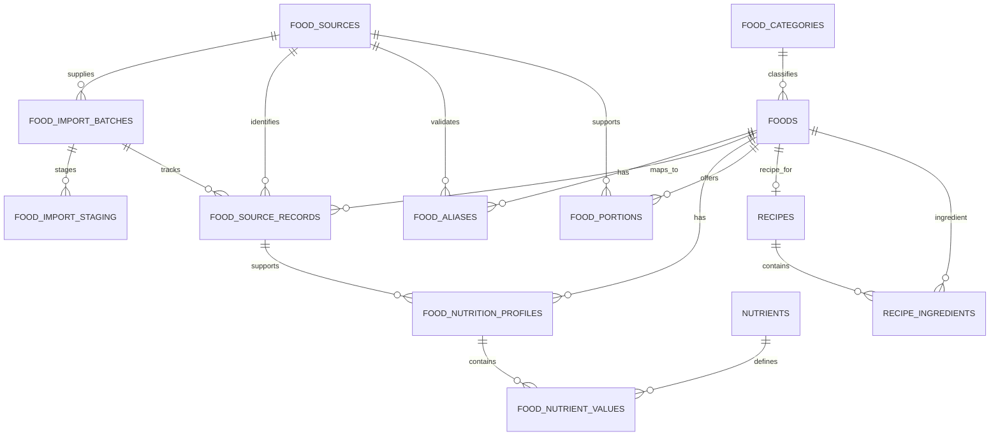

# Food catalogue data model

## ER relationship outline

## Entity responsibilities

| Table | Responsibility | Important rule |
|---|---|---|
| `foods` | Searchable canonical food entries, with preparation/product identity | Meaningfully different states such as dry and cooked food are separate food entries. |
| `food_aliases` | Alternative English/Tamil names, transliterations and search terms | An alias is language-tagged and can be marked verified. |
| `food_categories` | Stable application-owned categories | Do not make UI logic depend on source category spelling. |
| `food_sources` | Publisher, URL, license declaration and reuse review | A source's license assessment is recorded once and is not inferred from file availability. |
| `food_import_batches` | Reproducible dataset release and checksum | Every import gets a deterministic hash-based batch key. |
| `food_import_staging` | Raw source rows and QA flags before approval | No staging row is automatically a production food. |
| `food_source_records` | Links original source IDs/raw records to canonical foods | Supports deduplication, source attribution and re-audit. |
| `food_nutrition_profiles` | Alternative nutrition profiles for a canonical food | All values are relative to explicit `basis_amount` + `basis_unit`; profile selection happens only after review. |
| `nutrients` / `food_nutrient_values` | Nutrient dictionary and sparse values | A missing nutrient is not silently converted to zero. Units come from the nutrient definition. |
| `food_portions` | Count/cup/scoop-to-gram conversions | Only use gram conversions when the portion source is known; otherwise require grams or label serving size. |
| `recipes` / `recipe_ingredients` | Ingredient-based custom recipes and their cooked yield | Use exact ingredient states and quantity in grams; final batch yield controls per-100-g concentration. |

## Canonicalization rules

- The CSV source's integer `id` is a **source record ID**, not our application `foods.id`. Never use a dataset's local ID as a permanent database primary key.
- `canonical_key` is our stable app identifier, created after duplicate review. It is not just a source ID.
- A product label (for example one brand/flavour of whey) must not overwrite a generic whey entry or a different brand/flavour.
- A source record with a state not specified should retain `UNSPECIFIED`; do not label it RAW merely because it is an ingredient.
- Two sources reporting different values for paneer should remain separate candidate profiles or records until we know whether the preparation/fat composition differs. Do not average values.
- `0` is only a real reported zero. `NULL` means absent/unknown at a storage-column level; `food_nutrient_values.value_status` retains more specific source states such as trace, not measured or unreliable.
- Keep standard quantities in g/ml internally. Portion units are presentation helpers, not a substitute for source-backed mass conversion.

## Why the nutrient table is long-form

The nutrient list will grow (macros, fiber, sugar, saturated fat, sodium, micronutrients, etc.). With a separate dictionary and value table, new nutrient types can be added without repeated schema migrations. The food catalogue is small enough for the initial app; if reporting later requires speed, create a SQL view that pivots the five core values or use cached summary columns maintained by the service, while preserving the normalized source of truth.

## Food log history (for later app schema)

Each meal item should record the selected `food_id`, selected `food_nutrition_profiles.id`, consumed quantity, meal timestamp/type, and immutable nutrient totals at the moment of logging. This prevents corrections to source data from retroactively changing historical daily/weekly/monthly/yearly reports.
